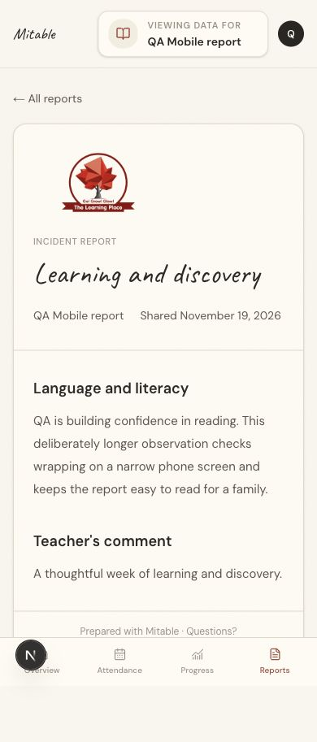
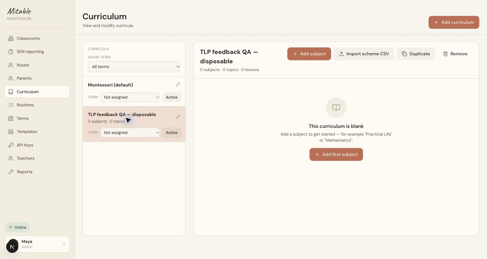
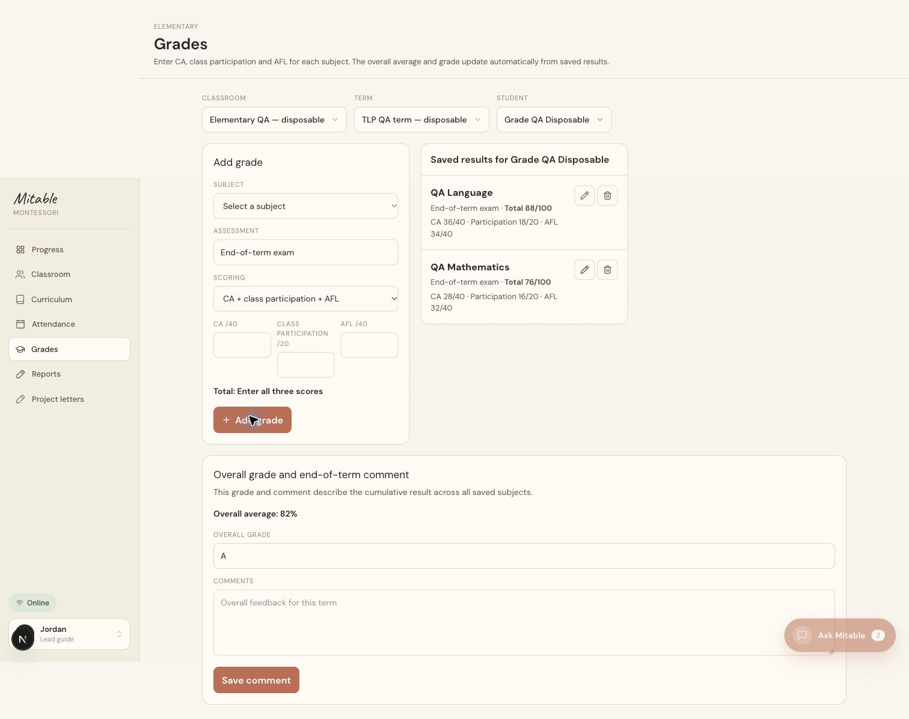

# TLP feedback: implementation and verification record

Work began 18 November and continued through the night of 19–20 November 2026 (New York). This record separates observed failures, implementation decisions, passing checks and remaining limits. No real parent was emailed during these tests.

## Environment and pre-release status

- Repository baseline: `84342abc4dd129b6c4e794419e557cfed469d7b9`.
- Railway production was still running that commit, deployed 10 November at 06:25 UTC. At that pre-release check, the changes described here were local repository changes, not a deployed release.
- Linked Supabase project: `cfhahyzspgnymuixxfhm`, named `mitable-montessori-dev`. It contains actual TLP usage as well as a separate demo school, so it was treated as customer data, not an empty sandbox.
- Browser tests used the local app and disposable demo-school records. Report mail was disabled in the local process. Provider tests used a fake sender/fake HTTP response. Database publication fixtures used reserved `.invalid` addresses; their recipients were suppressed, and fixtures were cleaned up afterward.
- Database migrations were applied and checked in the linked project. They retain existing progress and sent reports. The publication backfill and rollout bridge create no new email jobs.

## Source of truth and decisions

The verbatim TLP reports-feedback call of 11 November was read, with the 29 October call as supporting context. [11 November Granola source](https://notes.granola.ai/d/bc85acaa-0c7a-4fcb-b2df-0000eca4c6d9).

Confirmed requirements: curriculum subject choices; automatic mean; school-controlled letter ranges; remove daily/SEN/project highlights from the default term report; skills begin unrated; separate teacher/director comments. Mikun explicitly said school-owned choices such as thresholds, fields, order and logos belong in admin configuration. No TLP score ranges were invented.

On 19 November, Mikun confirmed that parent emails should be limited to explicitly shared reports and account access. Separate attendance emails are disabled; attendance remains in the portal.

## 1. Excess report emails

### Evidence

Recent database records included six student/day groups with two or three distinct daily reports addressed to the same email. There were no duplicate `(report_id, guardian_id)` rows in the aggregate checked. The earlier worker also lacked an atomic delivery claim and provider duplicate-prevention key. These are confirmed paths to excess notifications, but they do not identify which path affected the complainant.

The screenshot does not contain a full email address. Two bounded guardian-name searches did not produce a reliable match, so investigation moved to general behavior as requested. No real account was changed based on a guessed identity.

### Implementation and rationale

- `lib/reports/workflow.ts` prepares a safe report document and invokes the service-only `publish_report` database function from the explicit send routes.
- The database transaction locks the student/report-type/day, verifies the staff member's school and classroom access, checks for a concurrent edit, and compares parent-visible content. It creates an immutable publication and addressed recipients together. Repeated sends and identical cloned reports reuse the existing publication rather than producing another email for an existing recipient.
- Generated section/paragraph IDs and formatting whitespace do not count as material changes. Text, scores, ratings, section layout, logo and changed link targets do. A changed teacher email message alone does not resend an unchanged report.
- Published versions remain separate from editable drafts. Retrying a sent report reads its shared snapshot rather than silently refreshing classroom data or branding.
- `lib/admin/email-worker.ts` claims each recipient atomically. Concurrent workers cannot both own the same attempt. An interrupted claim can recover after five minutes using the same recipient key.
- `lib/email/resend.ts` sends `Idempotency-Key: report/<recipient-id>` and requires a returned message ID before confirming delivery. Resend documents a 24-hour key lifetime; attempts older than 23 hours stop for admin review rather than risking a duplicate. [Provider documentation](https://resend.com/docs/dashboard/emails/idempotency-keys).
- The send dialog distinguishes a delivered notification, delivery still being confirmed, and an unchanged version that caused no repeat email. Uncertain deliveries remain visibly held for review on subsequent retries.
- The old attendance-email panel was removed. `/api/v1/attendance/send` now returns a clear 409 response after authentication and never invokes delivery, including requests from old open tabs. Account invitation/recovery flows remain available.

This approach protects the actual side effect in the database and at the provider boundary; disabling a button alone would not protect simultaneous requests or retries.

### Tests and observed results

- **Real Postgres transaction, rolled back:** first send queued one recipient; repeat queued zero; an identical cloned report reused the original report/publication; saving a correction retained the old publication; explicit material update created one new publication/recipient; private AI fields were excluded; browser roles could not invoke the publication function. Passed.
- **Three simultaneous real RPC requests:** exactly one publication and one notification were queued. Passed. These were disposable records, no sender was invoked, and recipients were suppressed.
- **Real guardian session through public Supabase client:** own addressed publication returned; other students' publications returned no rows. Passed.
- **Worker regressions:** two simultaneous workers invoked the fake provider once; a later drain sent nothing again; a provider timeout retried with the same recipient key; an active claim waited; a stale claim recovered; an old uncertain attempt stopped and remained stopped; missing provider message ID did not count as delivery. Passed.
- **Email rendering:** correct parent report/child destination, TLP email branding and stable provider header were inspected using fake HTTP. Passed.
- **Attendance:** teacher register still rendered with Present/Absent controls and no email action. Old teacher/admin send requests returned 409 without invoking the sender; signed-out request returned 401. Passed.

## 2. Parent report access, branding and mobile layout

### Failures found and implementation

The sign-in middleware file was beside the repository root while the Next app was under `src/app`; Next did not load it. [Next.js requires middleware beside the app directory](https://nextjs.org/docs/15/app/api-reference/file-conventions/middleware). Moving it to `src/middleware.ts` made the compiled middleware manifest and real signed-out routing include it. It now preserves the report and child destination, routes parent home to parent login, removes forged identity headers, and keeps production redirects on the public origin instead of Railway's internal localhost port. API handlers retain their own authentication and JSON responses. Public fonts, manifest, worker, invitations and recovery routes remain accessible.

The recovery callback previously looked for a staff profile before sending guardians to the password form. Recovery now reaches `/update-password` first, and existing guardians return to the requested parent destination. The original report survives the login/recovery links, including the Back to sign in link. External redirects are rejected. Expired/invalid parent recovery callbacks return to parent password recovery with a clear explanation and the original report destination, rather than staff login; this failure path has its own regression test.

The parent detail, list and API now read addressed publications, so returning a sent report to draft does not remove the previously shared version. Missing access gives a useful account-switching screen rather than a dead end. Uploaded template logos are passed to the parent renderer, with TLP's existing brand fallback. Previous logo objects are retained when an admin replaces/removes the current choice so already-shared reports keep working.

The parent header now fits narrow screens. Long report text wraps. Grade tables scroll inside their card, with an instruction and keyboard-focusable region, rather than widening the whole page.

### Browser checks

- Opened a report link without a usable session, reached parent login with the exact report/child destination, signed in as the disposable guardian and reached that report. Passed.
- At **390 × 844**, the report showed TLP's loaded logo, title, paragraphs and footer; document width was exactly 390px. Passed.
- At **320 × 740**, long content wrapped; document width was exactly 320px. An initial cramped child selector was corrected and rechecked.
- Changed the underlying report to a private draft correction, reloaded the parent detail and list: last shared content remained visible; private correction did not appear. Passed.
- Explicitly published a revised fixture: parent list and detail displayed the revised version. Passed.
- Typed grades/skills fixture: overall 80%, grade A and selected/unrated skills rendered. The 480px grades table stayed inside a 236px scroll container; overall document width remained 320px. A first fixture omitted field-type metadata and therefore rendered as plain text; the fixture was corrected and the structured rendering was rechecked.
- Missing report displayed account-access help without exposing report content. Switching accounts opened parent login. Forgot password opened the parent recovery page while signed out. Passed.

These are real Chrome browser checks at phone viewports, not a physical iPhone/Safari test. No real recovery email was sent and no customer's password was changed. Callback/password destination behavior is covered by automated tests; inbox delivery and the complainant's individual account remain unverified. Attached media still follows the existing media-sharing workflow; this change versions the report document, not the underlying media files.

## 3. Curriculum deletion and the 2:53am complaint

### Time-window investigation

19 November **02:53 EST = 07:53 UTC**. Railway HTTP logs were checked for 07:40–08:10 UTC and Supabase logs for 07:35–08:20 UTC.

At 07:52 the deployed app successfully requested terms, curriculum list and curriculum detail. There was **no curriculum DELETE/PATCH request** in that window. Supabase recorded 238 requests in the broader interval, with three later progress-history failures around 08:13, unrelated to a curriculum write. The old deployed source only removed subjects/topics/lessons from React state.

The supported explanation is a missing persistence request in the deployed version, not evidence of a role-specific database outage. The logs cannot prove which item the IT user clicked or identify an exact click that never reached the server. The November 10 deployment also explains why the earlier local fix had not changed live behavior.

### Implementation and why

Subject, topic and lesson controls now call school-scoped DELETE endpoints and update the screen only after success. They archive records instead of erasing progress/history. A database trigger archives descendants in the same transaction. Active-tree filtering is applied to admin/teacher curriculum reads, progress and report generation. Archived lessons cannot receive new progress writes; active sibling rename/reorder and recreating a removed name are handled consistently. Confirmation explains that historical progress and sent reports are retained. Failed writes retain the original screen data and show an error.

### Verification

- Automated checks cover school ownership, rejected writes, archived descendants and active-tree filtering. Passed.
- An authenticated demo-admin database transaction verified cascading archive behavior, then rolled back. Passed.
- Browser fixture contained one subject, one topic and one lesson. Removed the lesson; waited for the DELETE 200 and dialog closure; reloaded/reselected: lesson absent. Repeated for topic, then subject: both absent after reload. Final database check showed all three records retained with `is_active=false`.
- An early browser attempt reloaded before a slow first compilation/write finished. That attempt was aborted and the item reappeared. The corrected check waited for request completion and re-ran the full persistence journey. Narrow-viewport automated clicks were inconclusive; final deletion checks used the normal browser viewport.

## 4. Earlier grade and report-layout feedback

### Subject dropdown and automatic mean

`lib/queries/elementary-grades.ts` reads active subjects from the teacher's assigned classroom curriculum; `app/app/grades/grades-client.tsx` renders a select. A retired subject is retained when editing its historical result. Missing curriculum choices explain what the admin must add.

The mean is computed from all saved subject scores. The school scale is stored separately, validated as ordered A/B/C boundaries, editable by school admins in Templates and readable by their school's staff. No thresholds are seeded for TLP. Until a school sets them, a letter grade stays unset; a manually submitted old overall letter is not trusted.

Real teacher browser check used two disposable subjects: 28+16+32 = **76**, then 36+18+34 = **88**. With the demo-only 80/65/50 scale, first result showed **76% / B**. After the second save and reload, it showed **82% / A**. A separate database query confirmed two saved rows and mean 82. These example thresholds were removed after testing; they are not TLP's scale.

Automated grade tests cover decimal/zero/boundary averages, missing/invalid scales, admin-only school isolation, curriculum choices, component entry and report compilation from saved grades. Passed.

### Term templates, skills and admin configuration

Admins can choose a default end-of-term layout for Elementary, Children's House, Toddler's House or a fallback for all classrooms. The existing editor now supports automatic curriculum progress, grades/mean, unrated term skills, teacher-entered sections, director-only comment and optional history blocks. Fields can be added/removed, titled and reordered, including mobile arrow controls, and a PNG/JPG logo can be uploaded. Defaults omit daily/SEN/project highlights; incident highlights remain configurable. Children's House and Toddler defaults include skills. Existing sent reports keep their snapshots; template changes apply to new reports.

Creation stores the selected template ID. Drafting and sending honor the stored section layout and metadata rather than reintroducing removed sections. Teacher additions and field order are preserved. Duplicate/conflicting singleton sections and invalid configuration are rejected.

Tests cover all classroom families, omission/reordering, custom heading/metadata, stale source refresh, preserved teacher text, skills initially unrated, selected terms, automatic grade payloads and sent-version behavior. The 39-case elementary flow and the broader term/toddler/SEN suites passed.

Browser admin verification duplicated the Elementary default, renamed the copy, moved Skills above Grades using arrows, saved and reloaded: name/order persisted. Logo upload endpoint accepted TLP's PNG and returned an accessible HTTP 200 image; browser reload showed the loaded logo preview. Chrome's file chooser was blocked by the extension's disabled file-URL permission, so that picker interaction itself was not passed off as verified. The actual upload route and saved browser preview were verified instead. The duplicate and uploaded QA asset were removed afterward.

## Checks, failed attempts and corrections

- Final automated suite: **436 passed, 79 files**. Earlier 420/76 suite passed before the new publication tests. After changing the send boundary, 27 old fake-database tests failed; fakes were updated to model the RPC boundary, with concurrency/security/deduplication separately checked in real Postgres. Subsequent test runs passed. Removing the obsolete attendance panel/tests accounts for the later file-count change.
- TypeScript check: passed. Lint: passed with existing image/hook warnings, no errors. An unused old test fake initially failed lint and was removed.
- Production build: passed (`next build`, exit 0), including generated routes and the middleware bundle. Final `tsc --noEmit`, `next lint` and `git diff --check` also passed. Lint retains pre-existing warnings.
- Production-mode HTTP smoke: signed-out report redirected to parent login with the exact report/child; forgot-password, manifest, worker and font returned 200; unsigned report API returned JSON 401; authenticated attendance send returned 409; report send without a mailer returned 503; the authenticated branded parent publication returned 200 with grades and skills. No provider was invoked.
- Cleanup: disposable students, reports/publications/recipients, grades, enrollment, classroom, curriculum, term, template copy, demo scale, uploaded asset and QA auth login were removed. Database counts for the fixture students/curriculum/template/demo scale were zero; auth-account absence was independently verified. Existing demo accounts and all customer accounts were retained.
- Both new skills passed the skill-creator validator. System Python lacked PyYAML; validation was rerun with PyYAML in an isolated temporary `uv` environment.
- First publication migration attempt hit legacy JSON-null sections (`cannot extract elements from scalar`); transaction rolled back. Array-type guards were added, then migration applied and real checks passed. The first database fixture used an unsupported relationship value; corrected to `guardian`. A fixture-only ambiguous `snapshot` SQL reference was qualified and rerun. A follow-up migration confirmation expired; it was retried and applied.
- Local tooling initially used a stale module path, then an incorrect public-key env name. Both were corrected; fixture creation/concurrent-send results were checked independently and the guardian-session test reran successfully. A grades fixture initially used a second active enrollment, which the database correctly rejected; a separate disposable student was used. The classroom fixture was given a supported Elementary code before the teacher check.
- Browser automation also caught a parent-header squeeze, missing recovery Back-link destination and server/client flag mismatch. Those were fixed and relevant checks rerun. Public flags now use literal environment accesses so Next bundles the same values into the browser.
- A keyboard scroll probe returned zero immediately, so it was not treated as a completed swipe test. Table width/overflow behavior and the rendered narrow layout were verified; physical touch scrolling was not tested.

Applied migration versions: `20261118144539`, `20261118144544`, `20261118144548`, `20261120040326`, `20261120042336`, `20261120044041`. The last two preserve old-deployment explicit sends during rollout and ensure changed link targets count as material changes. The rollout bridge was tested to create a publication and attach a legacy recipient while queuing **zero** emails.

The post-change Supabase security advisor reported no findings for the added publication table/functions. Existing unrelated advisories remain; this is not a claim of a clean project-wide security audit. [Supabase advisor reference](https://supabase.com/docs/guides/database/database-linter).

## Persistent working guidance

Created `skills/feedback-resolution/SKILL.md` and `skills/conversation-learnings/SKILL.md`, linked from the local `AGENTS.md`, with supported product/collaboration decisions in `docs/agent-learnings.md`. These require user-journey evidence, persistence/mobile checks where relevant, truthful release status, safe test recipients and scoped learnings rather than copying private customer details. Both skill files validated successfully.

## Remaining boundaries

At the end of pre-release verification, production still needed the application release; applied database changes alone do not replace the old email worker or browser controls. Mikun requested push and merge on 20 November; the release outcome is verified separately against the GitHub merge and Railway deployment. The complainant's exact account and inbox history were not identified. No physical iPhone/Safari or real inbox delivery test was performed. No promise of perfect behavior is inferred from passing automated checks; the above evidence is the basis for review.

Docker deployment verification also identified public feature flags missing from build-argument declarations. Those declarations were added so the literal browser/server flag reads receive the same Railway build settings.
